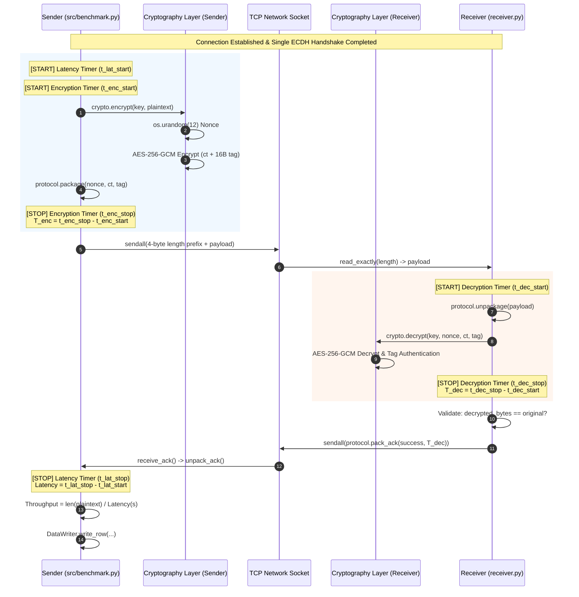
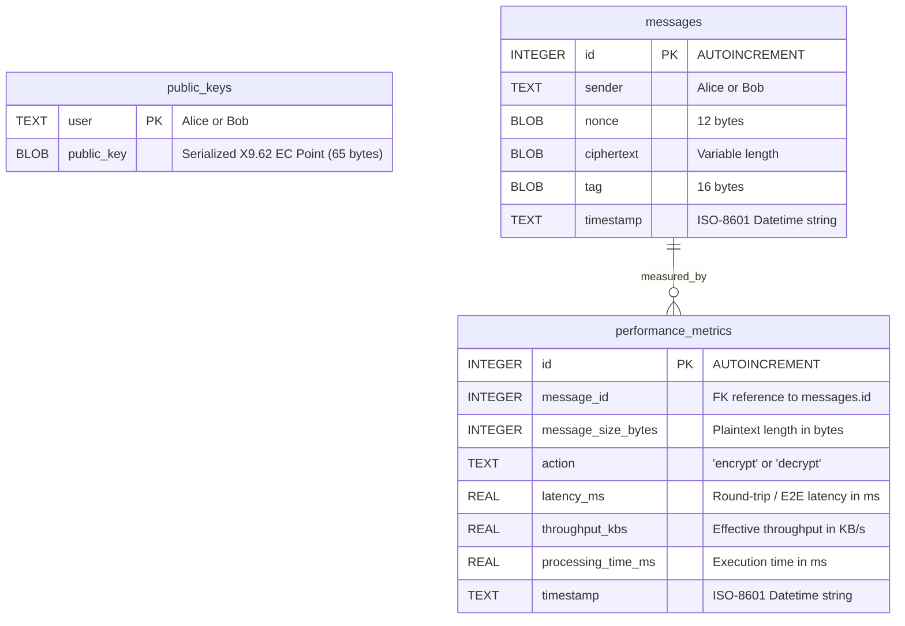
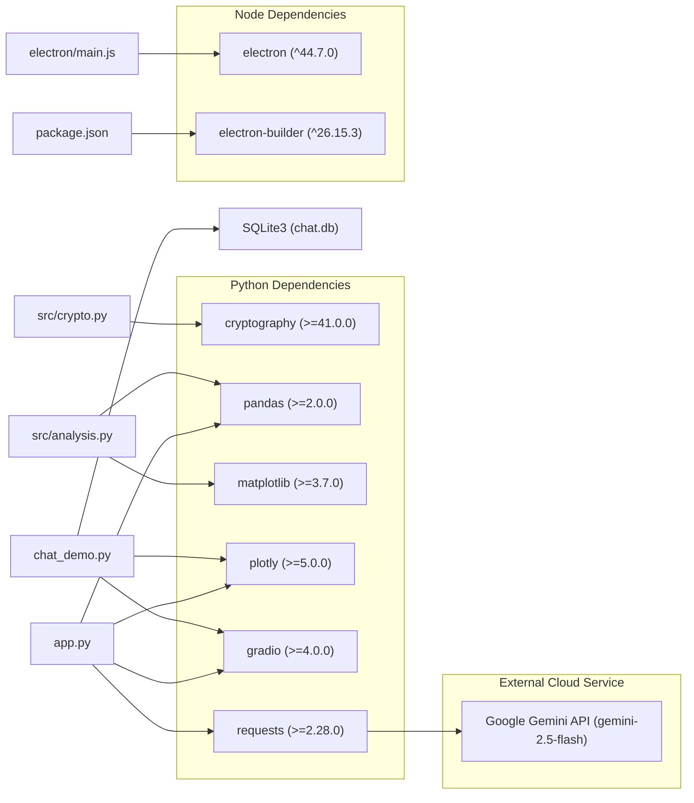

# PROJECT_CONTEXT.md: Technical Architecture & System Knowledge Base

> **Target Audience:** Large Language Models (LLMs), AI Agents, and Technical Architects.  
> **Document Purpose:** Definitive, code-grounded, single source of truth for the APPTA codebase. This document enables any subsequent LLM to understand the architecture, cryptographic pipelines, execution workflows, database schemas, IPC interfaces, testing guarantees, and known constraints without rescanning the entire repository.  
> **Author & Context:** Developed for the Undergraduate Thesis (*Tugas Akhir*) by Arwindo Sendy Pratama (`anywindo`, NIM `230712555@students.uajy.ac.id`) at Universitas Atma Jaya Yogyakarta (UAJY).  
> **Repository:** `anywindo/APPTA` | **Current Tag/Version:** `v1.0.1` | **License:** ISC.

---

## Table of Contents
1. [A. Project Overview](#a-project-overview)
2. [B. Technology Stack](#b-technology-stack)
3. [C. Repository Structure](#c-repository-structure)
4. [D. System Architecture](#d-system-architecture)
5. [E. Core Features and Business Logic](#e-core-features-and-business-logic)
6. [F. API and Interface Documentation](#f-api-and-interface-documentation)
7. [G. Database and Data Model](#g-database-and-data-model)
8. [H. Authentication and Security Architecture](#h-authentication-and-security-architecture)
9. [I. Configuration and Environment](#i-configuration-and-environment)
10. [J. Testing and Quality Assurance](#j-testing-and-quality-assurance)
11. [K. Dependencies and Integrations](#k-dependencies-and-integrations)
12. [L. Technical Decisions and Methodological Constraints](#l-technical-decisions-and-methodological-constraints)
13. [M. Current State and Known Issues](#m-current-state-and-known-issues)
14. [N. Guidance for Future LLMs & Operational Invariants](#n-guidance-for-future-llms--operational-invariants)
15. [O. Glossary and Reference Index](#o-glossary-and-reference-index)

---

## A. Project Overview

### 1. Research Identity and Purpose
The project **APPTA** (*Aplikasi Penelitian Tugas Akhir*) is an empirical scientific measurement instrument and demonstration platform built for the undergraduate computer science thesis:
> *"Analisis Pengaruh Ukuran Pesan terhadap Kinerja End-to-End Encryption Menggunakan ECDH dan AES-GCM pada Komunikasi Pesan"*  
> (*Analysis of the Effect of Message Size on End-to-End Encryption Performance Using ECDH and AES-GCM in Text Communication*).

The primary objective is to investigate the exact computational overhead and performance characteristics introduced by End-to-End Encryption (E2EE) as plaintext message payloads scale logarithmically across nine orders of magnitude.

### 2. Experimental Model
- **Independent Variable:** Message size (9 levels: $16\text{ B}$, $64\text{ B}$, $256\text{ B}$, $1\text{ KB}$, $4\text{ KB}$, $16\text{ KB}$, $64\text{ KB}$, $256\text{ KB}$, $1\text{ MB}$).
- **Primary Dependent Metrics:**
  1. *Encryption Time* ($T_{enc}$, in nanoseconds / milliseconds)
  2. *Decryption Time* ($T_{dec}$, in nanoseconds / milliseconds)
  3. *Application Round-Trip Latency* ($L$, in nanoseconds / milliseconds)
  4. *Effective End-to-End Throughput* ($\tau$, in bytes per second / KB/s)
- **Controlled Variables:** Cryptographic algorithms and parameters (SECP256R1, HKDF-SHA256, AES-256-GCM, 12-byte random nonce, 16-byte authentication tag), socket network stack, hardware execution environment.

### 3. Problems Solved
- **Measurement Boundary Isolation:** Solves the challenge of precisely measuring raw cryptographic execution time without polluting the data with TCP socket transmission delay, network jitter, or session-level key exchange costs.
- **Micro-benchmarking Rigor:** Eliminates interpreter warm-up anomalies, CPU cache latency spikes, and thermal throttling skew through mandatory warm-up runs, randomized message size scheduling, and Interquartile Range (IQR) outlier filtering.
- **Educational Demystification:** Provides an interactive chat simulator (Alice vs. Bob) with live byte-level cryptographic logs and database inspection, proving that an untrusted relay server possesses only ciphertexts, tags, and nonces.
- **Multi-Platform Native Packaging:** Packages a complex Python runtime (Gradio, Plotly, Pandas, Cryptography) inside an Electron desktop app with automatic lifecycle orchestration across macOS, Windows, and Linux.

### 4. Target Users and Use Cases
1. **Academic Researchers & Thesis Examiners:** Executing automated benchmark suites, inspecting summary statistics, downloading raw datasets (`results.csv`), and validating mathematical relationships via interactive Plotly charts.
2. **Students & Developers:** Learning how ECDH key agreement pairs with AES-GCM authenticated encryption through side-by-side interactive chat tabs.
3. **Automated CI/CD Workflows:** Building standalone multiplatform installers (`.dmg`, `.zip`, `.exe`, `.AppImage`, `.deb`) via GitHub Actions.

---

## B. Technology Stack

| Layer / Technology | Version / Requirement | Role in System | Key Configuration & Implementation File |
|---|---|---|---|
| **Python** | $\ge 3.9$ (Active runtime: $3.11$ in CI, $3.14$ in local dev) | Core benchmarking engine, sockets, cryptography, and analysis scripts | `runtime`, `run_e2e.py`, `src/` |
| **`cryptography`** | $\ge 41.0.0$ (Verified: $50.0.0$) | Asymmetric ECC primitives (`ec.SECP256R1`), HKDF derivation, and AEAD cipher (`AESGCM`) | `src/crypto.py`, `config.py` |
| **`pandas`** | $\ge 2.0.0$ | Dataset manipulation, IQR outlier rejection, group aggregation (mean, median, std, min, max) | `src/analysis.py`, `app.py` |
| **`matplotlib`** | $\ge 3.7.0$ | Automated static high-resolution PNG chart generation (300 DPI) with error bars | `src/analysis.py` |
| **`plotly`** | $\ge 5.0.0$ | Interactive, dynamic frontend charts with log-scale axes, trendlines (OLS/LOWESS), and tooltips | `app.py`, `chat_demo.py` |
| **`gradio`** | $\ge 4.0.0$ | Web GUI framework for both the Benchmark Suite (:7860) and the Interactive Chat Demo (:7861) | `app.py`, `chat_demo.py` |
| **`requests`** | $\ge 2.28.0$ | HTTP client for communicating with Google Gemini API | `app.py` |
| **`sqlite3`** | Standard Library | Mock untrusted central server storage simulating message and public key transport | `chat_demo.py`, `chat.db` |
| **Node.js** | $\ge 20.x$ | Runtime environment for build scripts, process orchestration, and Electron wrapper | `package.json`, `scripts/` |
| **Electron** | `^44.7.0` | Desktop container rendering dual embedded webviews with native OS integration | `electron/main.js`, `electron/preload.js` |
| **`electron-builder`**| `^26.15.3` | Multiplatform desktop app packager (DMG, NSIS, Portable, AppImage, DEB) | `package.json`, `.github/workflows/build.yml` |
| **`PyInstaller`** | $\ge 6.0.0$ | Binary freezer compiling Python backend scripts into standalone executables | `scripts/build_backends.py` |
| **Google Gemini API**| `gemini-2.5-flash` | LLM summarizer generating structured Markdown analysis tables in Indonesian | `app.py` (`generate_ai_summary`) |

---

## C. Repository Structure

```text
/Users/arw/Git/APPTA Electron
├── .agents/                        # Specifications, thesis ground truth, and methodology standards
│   ├── docs/                       # Thesis requirements, experimental design & finalized decisions
│   │   ├── 01_thesis_source_of_truth.md # Extracted research parameters and strict scope limits
│   │   ├── 02_python_implementation_requirements.md # Software design rules
│   │   ├── 03_experimental_design.md   # Mathematical model and metric definitions
│   │   ├── 04_resolved_technical_decisions.md # Initial technical choices
│   │   ├── 05_agent_operating_rules.md # Code style and agent rules
│   │   ├── 06_final_decisions.md       # Finalized 17 methodological decisions & SQuaRE/NIST/RFC mapping
│   │   ├── 07_phased_development.md    # Step-by-step phased engineering record (Phases 1-7)
│   │   └── Draft Proposal Baru.pdf     # Primary academic proposal source document
│   └── metodology/                 # Authoritative NIST, IETF RFC, and ISO/IEC 25010:2023 standards
├── .github/
│   └── workflows/
│       └── build.yml               # GitHub Actions multiplatform build & release pipeline
├── .Jules/                         # Automation & quality audit records
│   ├── palette.md                  # Accessibility (a11y) design decisions and fixes
│   └── sentinel.md                 # Security audit records (API key remediation)
├── assets/                         # Visual assets for chat avatars and packaging
│   ├── alice.jpeg                  # User avatar for Alice persona
│   └── bob.jpeg                    # User avatar for Bob persona
├── electron/                       # Desktop application source
│   ├── main.js                     # Main Electron process: backend spawn, IPC, menus, lifecycle
│   ├── preload.js                  # Secure contextBridge exposing window.electronAPI
│   └── renderer/                   # Front-end UI (HTML/CSS/JS) loaded inside Electron window
│       ├── app.js                  # Webview switching, log streaming, and status indicators
│       ├── index.html              # Shell layout with split webview containers and log drawer
│       └── styles.css              # Custom dark-theme styling and macOS vibrancy integration
├── results/                        # Timestamped experiment output directories
│   └── run_YYYYMMDD_HHMMSS/        # Isolated test run containing environment.json, CSVs, PNGs
├── scripts/                        # Build and packaging automation
│   ├── build_backends.py           # PyInstaller builder packaging app.py & chat_demo.py
│   ├── clean_dist.js               # Clean temporary build artifacts
│   └── run_python_build.js         # Cross-platform runner invoking build_backends.py
├── src/                            # Core measurement instrument & protocol library
│   ├── __init__.py                 # Package marker
│   ├── analysis.py                 # Outlier removal (IQR), aggregation, summary & PNG plotting
│   ├── benchmark.py                # BenchmarkRunner orchestration (warmups, randomization, loops)
│   ├── crypto.py                   # Cryptographic engine: P-256 ECDH, HKDF-SHA256, AES-256-GCM
│   ├── data.py                     # DataWriter streaming raw observations to CSV
│   ├── environment.py              # Hardware/OS environment profiler & standards metadata recorder
│   ├── i18n.py                     # Bilingual internationalization engine (EN/ID)
│   ├── logger.py                   # Standardized stream logger configuration
│   ├── network.py                  # Low-level TCP Socket wrappers (Sender and Receiver classes)
│   ├── protocol.py                 # Binary length-prefixed framing and ACK packing
│   └── timing.py                   # Sub-millisecond perf_counter_ns timer & throughput math
├── tests/                          # Automated unittest test suite (19 tests)
│   ├── test_benchmark.py           # Benchmark loop, randomization, and CSV generation test
│   ├── test_crypto.py              # Key exchange, tamper detection (InvalidTag), nonce & SP 800-38D checks
│   ├── test_network.py             # TCP socket client-server transmission tests
│   ├── test_protocol.py            # Packaging, length prefix, and X9.62 public key validation tests
│   └── test_timing.py              # Timer sanity, throughput division, and timing boundary validation
├── .gitignore                      # Git exclusion rules
├── .locale                         # Persistent active language code ("en" or "id")
├── app.py                          # Benchmark & Analysis Suite Gradio Web Application (:7860)
├── chat.db                         # SQLite database for the chat simulation
├── chat_demo.py                    # Interactive Educational Chat Demo Gradio Web Application (:7861)
├── chat_design.md                  # Architectural specification for chat_demo.py
├── config.py                       # Global experiment constants, standards metadata & validation
├── package.json                    # Node.js project manifest & electron-builder configuration
├── package-lock.json               # Locked npm dependency tree
├── receiver.py                     # Standalone CLI TCP Receiver process
├── requirements.txt                # Python package manifest
├── run_e2e.py                      # Master automated end-to-end experiment orchestration script
└── sender.py                       # Standalone CLI TCP Sender process
```

---

## D. System Architecture

### 1. Architectural Patterns
- **Layered Architecture:** The codebase strictly decouples raw cryptography (`src/crypto.py`), wire framing (`src/protocol.py`), network transport (`src/network.py`), timing instrumentation (`src/timing.py`), and high-level execution orchestration (`src/benchmark.py`).
- **Peer-to-Peer Socket Pipeline with Ephemeral Session Handshake:** Benchmarks run over raw TCP streams with zero intermediaries. Key exchange occurs once per session, establishing a symmetric session key for all subsequent messages.
- **Untrusted Central Server Simulation:** In the interactive chat demo, an SQLite database acts as an untrusted store-and-forward relay. The database never sees plaintexts, private keys, or derived symmetric keys.
- **Process Supervision Architecture (Electron):** Electron supervises two decoupled background Python child processes (`app.py` on port `7860`, `chat_demo.py` on port `7861`), streaming logs over asynchronous IPC to a slide-out drawer while hosting the applications in sandboxed `<webview>` tags.

### 2. End-to-End System Architecture Diagram

```mermaid
graph TD
    subgraph "Desktop Container (Electron)"
        E_Main["electron/main.js<br/>(Process Supervisor & IPC)"]
        E_Preload["electron/preload.js<br/>(contextBridge)"]
        E_Renderer["electron/renderer/<br/>(App Shell & Drawer)"]
        
        E_Main -->|Spawns :7860| Svc_App["app.py (Benchmark Suite)"]
        E_Main -->|Spawns :7861| Svc_Chat["chat_demo.py (Chat Demo)"]
        
        E_Main -->|stdout / stderr| E_Renderer
        E_Renderer -->|Webview 1| Svc_App
        E_Renderer -->|Webview 2 (Alice/Bob)| Svc_Chat
    end

    subgraph "Core Benchmarking Pipeline (CLI / E2E)"
        Runner["run_e2e.py / BenchmarkRunner"]
        SenderNet["src/network.py (Sender)"]
        ReceiverNet["src/network.py (Receiver)"]
        
        Runner -->|Generates random payload| SenderNet
        SenderNet <-->|1. TCP Handshake (ECDH P-256)| ReceiverNet
        SenderNet -->|2. Length-prefixed Encrypted Frame| ReceiverNet
        ReceiverNet -->|3. Binary ACK (Success + Dec Time)| SenderNet
        
        Runner -->|Writes Observations| CSV["results/run_*/results.csv"]
        CSV --> Analyzer["src/analysis.py<br/>(IQR Filter & Aggregation)"]
        Analyzer --> Plots["PNG Plots & summary.csv"]
    end

    subgraph "Interactive Chat Architecture"
        AliceTab["Chat Client: Alice<br/>(gr.Chatbot)"]
        BobTab["Chat Client: Bob<br/>(gr.Chatbot)"]
        SQLiteDB[("SQLite Server: chat.db<br/>(public_keys, messages, metrics)")]
        
        AliceTab -->|Stores Ephemeral Public Key| SQLiteDB
        BobTab -->|Stores Ephemeral Public Key| SQLiteDB
        AliceTab <-->|Derives Shared AES-256-GCM Key (RAM)| BobTab
        
        AliceTab -->|Inserts (nonce, ciphertext, tag)| SQLiteDB
        BobTab -->|Polls & Decrypts via Shared Key| SQLiteDB
    end
```

### 3. Request & Data Lifecycle: The Measurement Pipeline

The exact per-message measurement lifecycle follows strict operational boundaries:



---

## E. Core Features and Business Logic

### Feature 1: Automated E2EE Benchmark Pipeline
- **Purpose:** Executes empirical benchmarks over 9 message sizes with warm-ups, payload randomization, and high-resolution timing.
- **Entry Points:** `run_e2e.py` (CLI), `app.py` ("Run Experiment" button), `chat_demo.py` ("Planned Testing" tab).
- **Core Files:** [`src/benchmark.py`](file:///Users/arw/Git/APPTA%20Electron/src/benchmark.py), [`src/network.py`](file:///Users/arw/Git/APPTA%20Electron/src/network.py), [`src/timing.py`](file:///Users/arw/Git/APPTA%20Electron/src/timing.py), [`src/data.py`](file:///Users/arw/Git/APPTA%20Electron/src/data.py).
- **Execution Flow:**
  1. Reads `EXPERIMENT_REPETITIONS` environment variable (defaults to `30`).
  2. Generates an execution plan by shuffling `config.MESSAGE_SIZES` via `random.shuffle()` to avoid order-dependent biases (thermal throttling, OS memory caching).
  3. For each size:
     - Generates random bytes (`os.urandom(size)`).
     - Runs `config.WARMUP_RUNS` ($5$) unrecorded iterations.
     - Runs `config.MEASURED_RUNS` ($30$) iterations.
     - Records nanosecond timing for encryption, decryption, latency, and calculates throughput.
  4. Sends a special 0-byte plaintext message:
     ```python
     empty_nonce, empty_ciphertext, empty_tag = crypto.encrypt(self.sender.session_key, b"")
     self.sender.send_message(protocol.package(empty_nonce, empty_ciphertext, empty_tag))
     ```
  5. The receiver detects `len(plaintext) == 0 and success == True`, logs shutdown, and breaks its listening loop.

### Feature 2: Statistical Aggregation & Outlier Filtering
- **Purpose:** Cleans raw observations and outputs statistical summaries and charts.
- **Implementation File:** [`src/analysis.py`](file:///Users/arw/Git/APPTA%20Electron/src/analysis.py).
- **Data Filtering:**
  - Evaluates `success == True`.
  - Applies an **Interquartile Range (IQR)** filter on each group of message sizes:
    $$\text{IQR} = Q_3 - Q_1$$
    $$\text{Valid Range} = [Q_1 - 1.5 \times \text{IQR},\; Q_3 + 1.5 \times \text{IQR}]$$
  - Discards extreme outliers caused by OS kernel interrupts or socket buffer stalls.
- **Aggregation Metrics:** Computes `mean`, `median`, `std`, `min`, `max` for all four primary metrics.
- **Output Artifacts:** `summary.csv`, and 8 generated PNG plots (both nanosecond and millisecond variants, bytes/s and KB/s).

### Feature 3: Benchmark & Analysis Suite Web GUI
- **Purpose:** Full graphical interface for executing benchmarks, inspecting tables, and customizing plots.
- **Implementation File:** [`app.py`](file:///Users/arw/Git/APPTA%20Electron/app.py) (running on `http://127.0.0.1:7860`).
- **Features:**
  - **Live Log Streaming:** Uses a generator yielding `gr.update(value=log_output)` from a line-buffered subprocess executing `run_e2e.py`.
  - **Dynamic Plotly Engine:** Renders 4 synchronized charts with error bars representing $\text{Median} \pm \text{Std Dev}$. Features preset toggles (`Default (ms)`, `Default (ns)`, `Custom`).
  - **AI Research Assistant:** Sends the aggregated data table to Google Gemini API (`gemini-2.5-flash`) via `requests.post`, returning an academic Markdown summary table in Indonesian.
  - **Historical Run Browser:** Scans `/results` for past folders, allowing retrospective analysis.

### Feature 4: Interactive Educational Chat Demo
- **Purpose:** Demonstrates real-time E2EE messaging and cryptographic state transitions.
- **Implementation File:** [`chat_demo.py`](file:///Users/arw/Git/APPTA%20Electron/chat_demo.py) (running on `http://127.0.0.1:7861`).
- **Features:**
  - **Dual Persona Support:** Identity selection (`Alice` or `Bob`) passed via query parameter (`?user=Alice`, `?user=Bob`).
  - **Dynamic Key Derivation (`_sync_peer_key`):** Automatically detects when the peer registers their public key or regenerates an ephemeral key, immediately deriving a new shared secret in RAM and appending a `🔒 Your security code changed.` system notice in the chat.
  - **Database Browser:** Shows the raw contents of SQLite tables, illustrating that plaintexts are never accessible on the server.
  - **Performance Tracking:** Measures real-time encryption/decryption times and inserts rows into `performance_metrics`.

### Feature 5: Native Electron Desktop Shell
- **Purpose:** Native OS window management, process supervision, and side-by-side view container.
- **Implementation Files:** [`electron/main.js`](file:///Users/arw/Git/APPTA%20Electron/electron/main.js), [`electron/preload.js`](file:///Users/arw/Git/APPTA%20Electron/electron/preload.js), [`electron/renderer/`](file:///Users/arw/Git/APPTA%20Electron/electron/renderer).
- **Features:**
  - **Process Supervision:** Automatically starts both `app.py` and `chat_demo.py`, waits for HTTP healthiness via `checkServerReady()`, and forcefully frees occupied ports via `killPortProcess()` on startup/shutdown.
  - **Split-Screen Chat View:** Embeds two `<webview>` instances side-by-side: Alice on the left, Bob on the right.
  - **Terminal Drawer:** Slides out from the bottom to stream live Python `stdout` and `stderr` logs with filtering tabs (`All`, `Benchmark`, `Chat`).
  - **Accessibility (A11y):** WCAG compliant with explicit ARIA labels, `aria-expanded` states, and `:focus-visible` styling.

---

## F. API and Interface Documentation

### 1. Wire Protocol & Network Framing Specification
Communication between `sender.py` and `receiver.py` occurs over raw TCP streams using a custom binary framing protocol:

#### A. Handshake Phase (Public Key Exchange)
1. **Sender $\rightarrow$ Receiver:** 
   - `4 bytes` (Big-Endian `uint32`): Length of serialized public key ($L_{pub}$).
   - $L_{pub}$ bytes: Uncompressed SECP256R1 EC point (65 bytes, encoded via ANSI X9.62 format: `0x04 || X || Y`).
2. **Receiver $\rightarrow$ Sender:**
   - `4 bytes` (Big-Endian `uint32`): Length of serialized public key ($L_{pub}$).
   - $L_{pub}$ bytes: Receiver's uncompressed public key.
3. Both peers compute shared secret $S = \text{ECDH}(d_{local}, Q_{peer})$ and derive session key:
   $$K = \text{HKDF-SHA256}(\text{ikm}=S, \text{salt}=\text{None}, \text{info}=b\text{"handshake data"}, \text{length}=32\text{ bytes})$$

#### B. Data Transfer Phase (Encrypted Message Frame)
```text
+-----------------------+-------------------+---------------------+------------------+
|  Length Prefix (4B)   |    Nonce (12B)    | Ciphertext (Var B)  |  Auth Tag (16B)  |
|  Big-Endian uint32    |    os.urandom     |    AES-256-GCM      |   AES-256-GCM    |
+-----------------------+-------------------+---------------------+------------------+
|<----------------- Total Payload Size = Length Prefix ----------------------------->|
```

#### C. Acknowledgment Phase (ACK Frame)
The receiver responds to every decrypted message with an exact 9-byte binary ACK frame:
```text
+------------------------+-------------------------------+
|  Success Flag (1 Byte) |  Decryption Time (8 Bytes)    |
|   0x01 (OK) / 0x00 (F) |   Big-Endian uint64 (in ns)   |
+------------------------+-------------------------------+
```

### 2. Electron IPC API Interface
Exposed to the renderer via `contextBridge` in [`electron/preload.js`](file:///Users/arw/Git/APPTA%20Electron/electron/preload.js) under `window.electronAPI`:

| Method | Type | Arguments | Payload / Return Value | Description |
|---|---|---|---|---|
| `setActiveApp` / `switchApp` | Invoke (Promise) | `appKey: 'app' \| 'chat'` | `{ activeApp, services }` | Sets active application tab |
| `restartBackend` | Invoke (Promise) | `appKey: 'app' \| 'chat'` | `servicesSummary` | Stops and restarts targeted Python process |
| `openExternal` | Invoke (Promise) | `url?: string` | `void` | Opens URL in the system's default browser |
| `getState` | Invoke (Promise) | None | `{ activeApp, services, pythonPath }`| Retrieves current process supervisor state |
| `onBackendStatus` | Event Listener | `callback(statusData)` | `{ app, status, port, message, url }` | Subscribes to status changes (`starting`, `ready`, `error`, `stopped`) |
| `onBackendLog` | Event Listener | `callback(logPayload)`| `{ app: string, text: string }` | Streams live stdout/stderr chunks |
| `onInitialState` | Event Listener | `callback(state)` | `{ activeApp, services }` | Initial state handshake when window loads |
| `onSwitchTab` | Event Listener | `callback(appKey)` | `'app' \| 'chat'` | Triggered by keyboard shortcuts (`CmdOrCtrl+1/2`) |

### 3. External API: Google Gemini Integration
- **Endpoint:** `POST https://generativelanguage.googleapis.com/v1beta/models/gemini-2.5-flash:generateContent`
- **Authentication:** `X-goog-api-key: os.environ.get("GOOGLE_API_KEY")`
- **Request Payload:**
  ```json
  {
    "contents": [
      {
        "parts": [{ "text": "<Prompt containing tabular aggregated summary data>" }]
      }
    ]
  }
  ```
- **Error Handling:** Retries up to 3 times with a 2-second sleep on connection or rate-limit failure.

---

## G. Database and Data Model

The application uses an embedded **SQLite** database (`chat.db`) to simulate an untrusted central relay server.

### 1. Database Schema (`chat.db`)



### 2. Table Specifications
1. **`public_keys`**
   - Stores the active ephemeral public keys for registered participants.
   - Cleared on startup (`DELETE FROM public_keys`).
   - Replaced on key rotation (`INSERT OR REPLACE INTO public_keys`).
2. **`messages`**
   - Stores encrypted payloads. Contains **no plaintext data**.
   - Fields: `nonce` (12B), `ciphertext` (variable), `tag` (16B), `timestamp`.
3. **`performance_metrics`**
   - Real-time measurements generated during live chat interactions.
   - Captures processing duration, throughput, and end-to-end latency calculated by comparing `datetime.now()` against the ISO timestamp in `messages`.

### 3. File-Based Datasets (`results/`)
For the scientific experiment, observations are persisted as CSVs:
- **`results.csv`**: One record per measured execution.
  - Columns: `run_id` (UUIDv4), `message_size_bytes`, `encryption_time_ns`, `decryption_time_ns`, `latency_ns`, `throughput_bytes_per_s`, `success` (Boolean), `timestamp_utc` (ISO-8601 UTC).
- **`summary.csv`**: Aggregated statistics grouped by `message_size_bytes` with 41 statistical columns.
- **`environment.json`**: System hardware profile snapshot.

---

## H. Authentication and Security Architecture

### 1. Cryptographic Primitive Verification
- **Key Exchange:** ECDH over NIST P-256 (`SECP256R1`). Provides a 128-bit security level.
- **Key Derivation Function (KDF):** HKDF using SHA-256. Salt is omitted (`None`), and `info` is set to constant `b"handshake data"`. Derives a uniform 256-bit ($32\text{ bytes}$) symmetric key.
- **Authenticated Encryption with Associated Data (AEAD):** AES-256-GCM.
  - **Key Size:** 256 bits.
  - **Nonce Generation:** `os.urandom(12)` generates a cryptographically secure, random 96-bit nonce per message.
  - **Authentication Tag:** Full 128-bit ($16\text{ bytes}$) tag generated by the GCM polynomial hash (GHASH).
  - **Associated Data (AAD):** `None` (empty).

### 2. Key Isolation & In-Memory Secrets
- **Private Keys & Session Keys:** Reside strictly within the volatile process heap memory. They are never written to disk, SQLite, logs, or temporary files.
- **Ephemeral Lifecycle:** New keypairs are generated per session. When `chat_demo.py` restarts or "Regenerate Ephemeral Key" is pressed, the previous shared secret is permanently lost, ensuring forward secrecy for new messages.

### 3. Electron Security Controls
- **Context Isolation:** Enabled (`contextIsolation: true`). The renderer has no access to Node.js internals.
- **Node Integration:** Disabled (`nodeIntegration: false`).
- **Sandboxed IPC:** Only specifically whitelisted IPC handlers are exposed through `contextBridge` in [`electron/preload.js`](file:///Users/arw/Git/APPTA%20Electron/electron/preload.js).
- **Webview Isolation:** Webviews execute on local loopback URLs (`http://127.0.0.1:7860`, `http://127.0.0.1:7861`).

### 4. Known Security Boundaries & Academic Limitations
- **No PKI / Authentication Certificates:** The TCP socket protocol does not authenticate public keys (no X.509 certificates or trust-on-first-use signatures). It is vulnerable to an active Man-in-the-Middle (MitM) adversary on an untrusted network. This was an explicit methodological decision (#8, #9) as the research focuses strictly on computational encryption overhead across message sizes, not network authentication.
- **No User Authentication in Chat Demo:** Alice and Bob are selectable identities without passwords, designed strictly as an educational simulator.

---

## I. Configuration and Environment

### 1. Global Experiment Constants ([`config.py`](file:///Users/arw/Git/APPTA%20Electron/config.py))

```python
MESSAGE_SIZES = [16, 64, 256, 1024, 4096, 16384, 65536, 262144, 1048576]
MIN_RFC2544_LATENCY_TRIALS = 20
MEASURED_RUNS = int(os.environ.get("EXPERIMENT_REPETITIONS", 30))
WARMUP_RUNS = 5
ECDH_CURVE = "SECP256R1"
ECDH_PUBLIC_KEY_SIZE = 65  # bytes (0x04 || X || Y)
KDF_ALGORITHM = "HKDF-SHA256"
HKDF_HASH_LEN = 32         # bytes
HKDF_SALT = None
HKDF_INFO = b"handshake data"
AES_KEY_SIZE = 256         # bits
AES_BLOCK_SIZE_BITS = 128  # bits
NONCE_SIZE = 12            # bytes
TAG_SIZE = 16              # bytes
GCM_MAX_PLAINTEXT_BYTES = (1 << 36) - 32
GCM_MAX_INVOCATIONS = 1 << 32
LENGTH_PREFIX_SIZE = 4     # bytes
ACK_PAYLOAD_SIZE = 9       # bytes
```

### 2. Environment Variables

| Variable | Purpose | Default | Used In |
|---|---|---|---|
| `EXPERIMENT_REPETITIONS` | Overrides the number of measured repetitions per size | `30` | `config.py`, `run_e2e.py`, `app.py` |
| `E2E_RUN_FOLDER` | Specifies output directory for benchmark artifacts | Automatically generated `results/run_YYYYMMDD_HHMMSS` | `src/data.py`, `run_e2e.py` |
| `GRADIO_SERVER_PORT` | Custom port for Gradio web server | `7860` (`app.py`), `7861` (`chat_demo.py`) | `app.py`, `chat_demo.py`, `electron/main.js` |
| `GRADIO_SERVER_NAME` | Loopback binding address | `127.0.0.1` | `electron/main.js` |
| `GOOGLE_API_KEY` | API Key for Google Gemini 2.5 Flash analysis | Required for "Summarize" button | `app.py` (`generate_ai_summary`) |
| `PYTHONUNBUFFERED` | Forces line-buffered stdout for real-time log streaming | Set to `1` by Electron supervisor | `electron/main.js` |
| `GH_TOKEN` | GitHub Token for automatic release uploads | Required during CI build tag releases | `.github/workflows/build.yml` |

### 3. Execution Commands
```bash
# 1. Run full unit test suite
python -m unittest discover tests

# 2. Execute automated E2E benchmark pipeline (CLI)
python run_e2e.py

# 3. Launch the Benchmark & Analysis Suite Web App
python app.py

# 4. Launch the Interactive Chat Demo Web App
python chat_demo.py

# 5. Launch the Electron Desktop Application
npm start

# 6. Build Standalone Python Binaries (via PyInstaller)
npm run build:python

# 7. Package Native Desktop App (via Electron Builder)
npm run pack       # Local unpackaged testing
npm run dist:mac   # macOS DMG / ZIP
npm run dist:win   # Windows NSIS / Portable
npm run dist:linux # Linux AppImage / DEB
```

---

## J. Testing and Quality Assurance

### 1. Test Architecture
The test suite is built on Python's native `unittest` framework, located in [`tests/`](file:///Users/arw/Git/APPTA%20Electron/tests). All 19 tests pass deterministically.

```text
tests/
├── test_crypto.py      # 6 tests: encrypt/decrypt all 9 sizes, distinct nonces, InvalidTag on tamper, key equality, KDF determinism, SP 800-38D input validation
├── test_protocol.py    # 4 tests: packaging round-trip, 4-byte length prefix math, public key ANSI X9.62 serialization, invalid public key rejection
├── test_network.py     # 2 tests: single client-server TCP exchange, multi-message stream transmission
├── test_timing.py      # 6 tests: timer positive elapsed, throughput math, zero latency guard, ACK packing, timing boundary isolation
└── test_benchmark.py   # 1 test: full mini-benchmark run with randomized sizes, warmups, and CSV output validation
```

### 2. Critical Test Guarantees: Timing Boundary Sanity
[`tests/test_timing.py`](file:///Users/arw/Git/APPTA%20Electron/tests/test_timing.py) implements a specialized multithreaded test (`test_timing_boundaries_sanity`) verifying that artificial network delays injected into the socket transport do **not** inflate measured encryption or decryption times:
1. Simulates a $50\text{ ms}$ socket delay on both transmission and reception ($100\text{ ms}$ total RTT).
2. Asserts that $T_{enc} < 50\text{ ms}$ and $T_{dec} < 50\text{ ms}$.
3. Asserts that measured Latency $\ge 100\text{ ms}$.
4. Asserts that $\text{Latency} \ge T_{enc} + T_{dec}$.

---

## K. Dependencies and Integrations



---

## L. Technical Decisions and Methodological Constraints

The 17 authoritative methodological decisions documented in [`.agents/docs/06_final_decisions.md`](file:///Users/arw/Git/APPTA%20Electron/.agents/docs/06_final_decisions.md) and grounded in the normative standards in [`.agents/metodology/`](file:///Users/arw/Git/APPTA%20Electron/.agents/metodology) define the scientific validity of the codebase:

| # | Decision Topic | Resolution | Normative Standard & Methodological Rationale | Trade-offs & Implications |
|---|---|---|---|---|
| 1 | **ECDH Lifecycle** | Once per session | **NIST SP 800-56A Rev. 3 (Sec. 6.1, $C(2e, 0s)$):** Ephemeral key agreement performed once per session; ephemeral private key references released immediately after derivation (Sec. 8, best-effort in CPython). | Isolates symmetric encryption scaling from session handshake cost. |
| 2 | **Encryption Boundary** | Nonce generation $\rightarrow$ AES-GCM encryption $\rightarrow$ Package assembly | **NIST SP 800-38D (Sec. 7.1, Algorithm 4 $\text{GCM-AE}$) & ISO/IEC 25010:2023(E) (Clause 3.2.1 Time behaviour, Annex C.2):** Captures 96-bit RBG IV generation, `GCTR` + `GHASH` computation, and frame assembly as an external dynamic processing-time measure. Excludes session setup and socket I/O. | Any refactoring of `package()` or `encrypt()` directly impacts measured encryption time. |
| 3 | **Decryption Boundary** | Payload parsing $\rightarrow$ AES-GCM decryption/authentication | **NIST SP 800-38D (Sec. 7.2, Algorithm 5 $\text{GCM-AD}$) & ISO/IEC 25010:2023(E) (Clause 3.2.1 Time behaviour, Annex C.2):** Captures frame unpacking, Step 1 input-length checks, `GHASH` tag verification ($T = T'$), and `GCTR` plaintext recovery. | GCM tag verification is internal to the timing window. |
| 4 | **Latency Definition** | Application Round-Trip: $T_{\text{ack received}} - T_{\text{before encrypt}}$ | **ISO/IEC 25010:2023(E) (Clause 3.2.1 Time behaviour — response time) & Adapted from IETF RFC 2544 (Sec. 26.2) — deviation:** RFC 2544 latency is one-way ($\text{Timestamp B} - \text{Timestamp A}$) at the zero-loss throughput rate. Here it is application round-trip response latency (including encryption, decryption, and ACK) to avoid assuming symmetric network paths ($\text{RTT}/2$). | Includes network transmission time and receiver processing time. |
| 5 | **Throughput Definition** | Effective Throughput: $\text{Plaintext Bytes} / \text{Latency (seconds)}$ | **ISO/IEC 25010:2023(E) (Clause 3.2.1 Time behaviour — throughput rate) & Adapted from IETF RFC 2544 (Sec. 26.1) — deviation:** Reports effective per-message payload transfer rate in bytes/s rather than RFC 2544's iterative max zero-loss offered frame rate. | Approaches link speed as payloads grow, but drops for small payloads due to per-message overhead. |
| 6 | **Message Sizes** | 9 levels: 16B, 64B, 256B, 1KB, 4KB, 16KB, 64KB, 256KB, 1MB | **ISO/IEC 25010:2023(E) (Clause 3.8.2 Scalability, Clause 3.2.3 Capacity) & IETF RFC 2544 (Sec. 9, Frame Sizes):** Evaluates workload scalability across $\ge 5$ payload sizes spanning minimum to maximum bounds with finer granularity at smaller sizes. | 1MB payload requires chunked TCP streaming handled by `read_exactly()`. |
| 7 | **Repetitions** | 5 warm-ups + 30 measured runs per size (270 measured total) | **IETF RFC 2544 (Sec. 26.2):** Conforms to $\ge 20$ repeated trials for latency reporting; $N=30$ satisfies both RFC 2544 and Central Limit Theorem requirements. | Total runtime takes ~25–40 seconds per full benchmark run. |
| 8 | **Topology / Transport**| Direct Client-to-Client TCP (`127.0.0.1` loopback or controlled LAN). No relay. | **IETF RFC 2544 (Sec. 6, Test Set Up):** Isolated point-to-point topology without external routing or relay queuing noise. | Defaults to `127.0.0.1` loopback; configurable via CLI `--host`/`--port` for LAN. |
| 9 | **ECDH Curve** | SECP256R1 (NIST P-256) | **NIST FIPS 186-5 (App. A.2) & SP 800-56A Rev. 3 (App. D, Table 24):** Approved prime-field curve providing 128-bit security strength. | Curve25519 was excluded to adhere to NIST standard thesis parameters. |
| 10| **KDF Algorithm** | HKDF-SHA256 | **NIST SP 800-56C Rev. 2 (Sec. 5) & IETF RFC 5869 (Sec. 2):** Two-step Extract-then-Expand KDF; local shared secret $Z$ reference is released after derivation (SP 800-56C Sec. 8.4, best-effort). | SHA-256 matches the 128-bit security level of P-256. |
| 11| **AES-GCM Parameters** | 256-bit key, 12-byte random nonce, 128-bit tag, empty AAD | **NIST FIPS 197 (Upd. 1), NIST SP 800-38D (Secs. 5.2.1, 8.2.2, 8.3) & ISO/IEC 25010:2023(E) (Clause 3.6.1 Confidentiality, Clause 3.6.2 Integrity):** AES-256 (14 rounds), 96-bit RBG IV, 128-bit tag ($t=128$), $\le 2^{32}$ invocations per key tracked via `hash(key)`. | 12-byte random nonces must not exceed $2^{32}$ invocations under the same key. |
| 12| **Wire Format** | 4-byte big-endian length prefix $\Vert$ Nonce (12B) $\Vert$ Ciphertext $\Vert$ Tag (16B) | **NIST SP 800-56A Rev. 3 (Sec. 3.1, App. C) & SP 800-38D:** Big-endian framing over TCP; 65-byte ANSI X9.62 uncompressed public key (`0x04 || X || Y`) with point validation. | Frame header is fixed at 32 bytes of overhead per message. |
| 13| **Warm-up Policy** | 5 unrecorded warm-up runs per size | **Analogous to IETF RFC 2544 (Sec. 23, trial phases a–b):** Primes interpreter caches and OS socket buffers before measured trials (note: single-message trials deviate from RFC 2544 Sec. 24's $\ge 60\text{ s}$ continuous stream duration). | Warm-up runs are discarded prior to CSV logging. |
| 14| **Aggregation** | Mean, Median, Standard Deviation, Minimum, Maximum | **IETF RFC 2544 (Sec. 26.2) + Methodological Additions:** Mean satisfies RFC 2544 Sec. 26.2; median, std dev, min, max, and $1.5\times\text{IQR}$ outlier filtering are methodological additions motivated by RFC 2544 Sec. 4. | Median is preferred for primary plotting to resist system jitter. |
| 15| **Execution Order** | Shuffled randomized order across size conditions | **Methodological Decision (motivated by RFC 2544 Sec. 4):** Eliminates time-dependent systematic errors (CPU thermal throttling, garbage collection accumulation). | Code must handle out-of-order size processing during CSV write. |
| 16| **Dataset Schema** | Flat CSV with 8 standardized columns | **IETF RFC 2544 (Sec. 26 Reporting Format):** Minimalist, portable format paired with `environment.json` DUT/standards metadata. | Extra metrics (CPU/RAM) are relegated to `environment.json`. |
| 17| **Validation Policy**| If tag verification or frame length check fails: mark `success=false`, continue | **NIST SP 800-38D (Sec. 7.2 Step 8), IETF RFC 2544 (Sec. 10) & ISO/IEC 25010:2023(E) (Clause 3.1.2 Functional correctness, Clause 3.5.3 Fault tolerance):** Receiver verifies GCM authentication tag (`InvalidTag`, forgery prob $\le 2^{-128}$) and frame length (`len(P) == len(C)`). | Failed runs are preserved in raw CSV but filtered out of aggregation. |

### ISO/IEC 25010:2023(E) SQuaRE Product Quality Mapping

| ISO/IEC 25010:2023 Clause | Quality Characteristic / Subcharacteristic | Implementation & Measurement Mapping in APPTA |
|---|---|---|
| **Clause 3.2.1** | **Performance efficiency → Time behaviour** | Primary dependent metrics: `encryption_time_ns` (Decision #2), `decryption_time_ns` (Decision #3), `latency_ns` response time (Decision #4), and `throughput_bytes_per_s` rate (Decision #5) in `src/timing.py` and `src/benchmark.py`. |
| **Clause 3.2.2** | **Performance efficiency → Resource utilization** | Supporting/controlled hardware context (CPU cores, frequency, RAM, OS) captured in `src/environment.py` (`environment.json`), explicitly separated from primary dependent metrics per `.agents/docs/01_thesis_source_of_truth.md`. |
| **Clause 3.2.3** | **Performance efficiency → Capacity** | Payload bounds up to $1\text{ MB}$ (`MESSAGE_SIZES` in `config.py`) and NIST SP 800-38D upper limits (`GCM_MAX_PLAINTEXT_BYTES`, `GCM_MAX_INVOCATIONS`). |
| **Clause 3.8.2** | **Flexibility → Scalability** *(new in 2023 edition)* | Primary independent variable: characterizing how E2EE time behaviour adapts across 9 logarithmically growing payload workloads ($16\text{ B}$ to $1\text{ MB}$, Decision #6) in `src/benchmark.py` and `src/analysis.py`. |
| **Clause 3.6.1 & 3.6.2** | **Security → Confidentiality & Integrity** | Ephemeral ECDH P-256 (`SECP256R1`) + `HKDF-SHA256` + `AES-256-GCM` authenticated encryption (`GCTR` + 128-bit `GHASH` tag) in `src/crypto.py`. |
| **Clause 3.1.2 & 3.5.3** | **Functional correctness & Fault tolerance** | Exact plaintext recovery verification (`tests/test_crypto.py`, `receiver.py`) and resilient recording/filtering of failed runs (`success=False`, Decision #17) without crashing the benchmark session. |
| **Annex C (C.2, Table C.1)** | **External quality measures of dynamic behaviour** | Execution of `run_e2e.py` / `BenchmarkRunner` measures dynamic computer-system-dependent behaviour under controlled conditions (`environment.json`). |

### Standards Conformance Gaps (Known Deviations)

| Standard | Requirement | Status in this codebase |
|---|---|---|
| RFC 2544 Sec. 26.1 | Throughput = max zero-loss rate | **Deviation** — effective per-message throughput (Decision 5) |
| RFC 2544 Sec. 26.2 | One-way latency at throughput rate | **Deviation** — application round-trip latency (Decision 4) |
| RFC 2544 Sec. 24 | $\ge 60\text{ s}$ per trial | **Deviation** — single-message trials |
| SP 800-56A Sec. 5.8.2 / App. B, SP 800-56C Sec. 5.1 | `FixedInfo` should bind party identifiers / context | **Partial** — `info = b"handshake data"` is a fixed label only |
| SP 800-56A Sec. 5.9 | Key confirmation | **Not implemented** (optional in SP 800-56A) |
| SP 800-56A Sec. 8 / SP 800-56C Sec. 8.4 | Destroy ephemeral private keys and $Z$ | **Best-effort** — references released; CPython cannot zeroize memory |
| SP 800-38D Sec. 9 | FIPS 140 validation | **Out of scope** — `cryptography`/OpenSSL is not run in FIPS mode |

---

## M. Current State and Known Issues

### 1. Implementation Status Matrix
- **Core Benchmarking Engine (`src/`):** **100% Complete & Verified.** Fully compliant with thesis requirements.
- **Automated Analysis & Plotting (`src/analysis.py`):** **100% Complete & Verified.** Generates all 8 PNGs and summary CSV.
- **Benchmark Suite GUI (`app.py`):** **100% Complete.** Plotly integration, real-time streaming subprocess logs, AI summarizer active.
- **Interactive Chat Demo (`chat_demo.py`):** **100% Complete.** SQLite integration, dual-view client, automatic key sync, DB browser.
- **Desktop Electron Shell (`electron/`):** **100% Complete.** Dual backend supervision, split-view webview, log drawer, A11y compliant.
- **CI/CD Pipeline (`.github/workflows/build.yml`):** **100% Complete.** Multiplatform build automation for macOS, Windows, and Linux.

### 2. Known Quirks and Technical Debt
1. **macOS Case-Insensitive Filesystem Collision (`.Jules` vs `.jules`):**
   - In git commit history, `.Jules/palette.md` and `.jules/palette.md` were committed with different casing.
   - On macOS (APFS case-insensitive), checking out can create a perpetual dirty diff.
   - **Remedy:** Resolved via `git update-index --assume-unchanged .Jules/palette.md`.
2. **Port Collisions on Abrupt Termination:**
   - If Python is killed abruptly without Electron's clean shutdown, ports `7860` or `7861` may remain occupied by zombie processes.
   - **Mitigation:** [`electron/main.js`](file:///Users/arw/Git/APPTA%20Electron/electron/main.js) implements `killPortProcess(port)` executing `lsof -ti :port | xargs kill -9` (Unix) or `netstat -ano` + `taskkill` (Windows) before spawning.
3. **Google API Key Dependency:**
   - The "Summarize" button in `app.py` requires `GOOGLE_API_KEY` set in the environment; otherwise, it returns a descriptive error message in the UI box.

---

## N. Guidance for Future LLMs & Operational Invariants

When modifying, extending, or debugging this repository, you **MUST** adhere to the following strict operational rules:

### 1. Invariants That Must NEVER Be Broken
1. **DO NOT change timing boundary implementations:**
   - In [`src/benchmark.py`](file:///Users/arw/Git/APPTA%20Electron/src/benchmark.py), `enc_timer` must wrap `crypto.encrypt` and `protocol.package`. It must **never** include socket `send_message`.
   - In [`receiver.py`](file:///Users/arw/Git/APPTA%20Electron/receiver.py), `dec_timer` must wrap `protocol.unpackage` and `crypto.decrypt`. It must **never** include socket `receive_message` or `send_ack`.
2. **DO NOT modify cryptographic parameters in [`config.py`](file:///Users/arw/Git/APPTA%20Electron/config.py):**
   - The curve (`SECP256R1`), key size (`256`), nonce size (`12`), tag size (`16`), and message sizes (`[16, ..., 1048576]`) are defined by academic thesis ground truth.
3. **DO NOT remove the 0-byte stop signal:**
   - `receiver.py` relies on receiving an authenticated 0-byte plaintext to gracefully terminate its listening loop.
4. **DO NOT hardcode secrets or API keys:**
   - Always access external credentials via `os.environ.get("GOOGLE_API_KEY")`.
5. **DO NOT enable Node Integration in Electron:**
   - Maintain `nodeIntegration: false` and `contextIsolation: true` in `electron/main.js`.

### 2. Authoritative Files to Consult First
- If investigating **thesis scope or variables:** Consult [`.agents/docs/01_thesis_source_of_truth.md`](file:///Users/arw/Git/APPTA%20Electron/.agents/docs/01_thesis_source_of_truth.md).
- If investigating **experimental decisions & rationale:** Consult [`.agents/docs/06_final_decisions.md`](file:///Users/arw/Git/APPTA%20Electron/.agents/docs/06_final_decisions.md).
- If investigating **wire protocol & framing:** Consult [`src/protocol.py`](file:///Users/arw/Git/APPTA%20Electron/src/protocol.py).
- If investigating **IPC or Electron process lifecycle:** Consult [`electron/main.js`](file:///Users/arw/Git/APPTA%20Electron/electron/main.js).

### 3. Verification Protocol
After making any code changes, immediately run:
```bash
python -m unittest discover tests
```
Ensure all 19 tests pass before reporting task completion.

---

## O. Glossary and Reference Index

### 1. Terminology & Abbreviations
- **AEAD:** Authenticated Encryption with Associated Data (e.g., AES-GCM). Provides confidentiality and integrity verification simultaneously.
- **APPTA:** *Aplikasi Penelitian Tugas Akhir* (Undergraduate Thesis Experimental Application).
- **ECDH:** Elliptic Curve Diffie-Hellman. Key agreement protocol allowing two parties to establish a shared secret over an insecure channel.
- **HKDF:** HMAC-based Extract-and-Expand Key Derivation Function (RFC 5869).
- **IQR:** Interquartile Range ($Q_3 - Q_1$). Statistical dispersion metric used to filter transient benchmarking anomalies.
- **NIST P-256 (SECP256R1):** Standard elliptic curve defined over a 256-bit prime field.
- **Nonce:** Number used once (12 bytes in AES-GCM). Must never repeat under the same symmetric key.
- **RTT:** Round-Trip Time.

### 2. Feature-to-Code Cross-Reference Matrix

| Feature | Primary Code Entry | Supporting Modules | Database / Storage | Verification Test |
|---|---|---|---|---|
| **P-256 Key Exchange** | [`src/crypto.py`](file:///Users/arw/Git/APPTA%20Electron/src/crypto.py) (`generate_keypair`, `derive_shared_key`) | [`src/protocol.py`](file:///Users/arw/Git/APPTA%20Electron/src/protocol.py) | In-Memory | [`tests/test_crypto.py`](file:///Users/arw/Git/APPTA%20Electron/tests/test_crypto.py) |
| **AES-256-GCM AEAD** | [`src/crypto.py`](file:///Users/arw/Git/APPTA%20Electron/src/crypto.py) (`encrypt`, `decrypt`) | [`config.py`](file:///Users/arw/Git/APPTA%20Electron/config.py) | In-Memory | [`tests/test_crypto.py`](file:///Users/arw/Git/APPTA%20Electron/tests/test_crypto.py) |
| **TCP Framing & Sockets**| [`src/network.py`](file:///Users/arw/Git/APPTA%20Electron/src/network.py) (`Sender`, `Receiver`) | [`src/protocol.py`](file:///Users/arw/Git/APPTA%20Electron/src/protocol.py) | Loopback / LAN | [`tests/test_network.py`](file:///Users/arw/Git/APPTA%20Electron/tests/test_network.py) |
| **Benchmark Runner** | [`src/benchmark.py`](file:///Users/arw/Git/APPTA%20Electron/src/benchmark.py) (`BenchmarkRunner`) | [`src/timing.py`](file:///Users/arw/Git/APPTA%20Electron/src/timing.py), [`src/data.py`](file:///Users/arw/Git/APPTA%20Electron/src/data.py) | `results/run_*/results.csv` | [`tests/test_benchmark.py`](file:///Users/arw/Git/APPTA%20Electron/tests/test_benchmark.py) |
| **Data Aggregation & IQR**| [`src/analysis.py`](file:///Users/arw/Git/APPTA%20Electron/src/analysis.py) (`compute_aggregation`) | `pandas`, `matplotlib` | `summary.csv`, `*.png` | [`run_e2e.py`](file:///Users/arw/Git/APPTA%20Electron/run_e2e.py) |
| **Benchmark Suite GUI** | [`app.py`](file:///Users/arw/Git/APPTA%20Electron/app.py) | `gradio`, `plotly`, `src/i18n.py` | `results/` | Manual / Webview |
| **Interactive Chat Demo**| [`chat_demo.py`](file:///Users/arw/Git/APPTA%20Electron/chat_demo.py) | `gradio`, [`src/crypto.py`](file:///Users/arw/Git/APPTA%20Electron/src/crypto.py) | [`chat.db`](file:///Users/arw/Git/APPTA%20Electron/chat.db) (`sqlite3`) | Manual / Webview |
| **Desktop Shell** | [`electron/main.js`](file:///Users/arw/Git/APPTA%20Electron/electron/main.js) | [`electron/preload.js`](file:///Users/arw/Git/APPTA%20Electron/electron/preload.js), [`electron/renderer/`](file:///Users/arw/Git/APPTA%20Electron/electron/renderer) | OS Window | `npm start` |
| **Cross-Platform Bundler**| [`scripts/build_backends.py`](file:///Users/arw/Git/APPTA%20Electron/scripts/build_backends.py) | `PyInstaller`, `electron-builder` | `dist/`, `build/bin/` | `.github/workflows/build.yml` |
